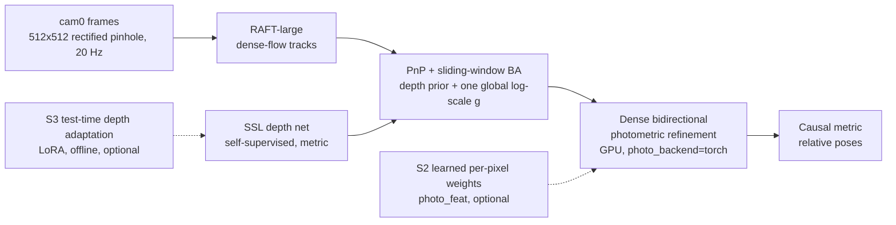
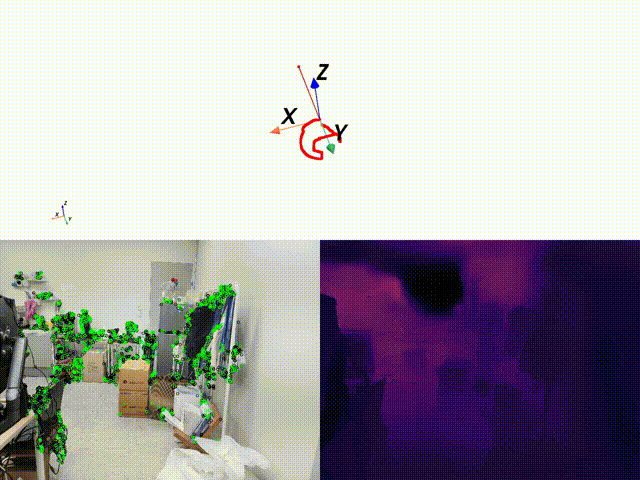

# Deep-Visual-SLAM-Monodepth2

[]()

<p align="center">
 
 
 
 
</p>

<p align="center">
 
 
 
 
 
</p>

<p align="center">
  
</p>

<p align="center"><sub>TUM-VI <code>room6</code>, a room not used for training: cam0 with tracked points (left), top-down metric trajectory vs. mocap ground truth (right). No scale alignment.</sub></p>

## Overview

`dvslam` is a monocular metric visual odometry system for low-parallax, high-frame-rate indoor sequences. Geometry
carries the pose path: dense optical-flow tracks, PnP and a sliding-window bundle adjustment, refined by a dense
photometric step. A self-supervised depth network provides the metric scale prior. Inference uses a single RGB camera;
stereo images and the gyroscope are used only while training the depth network.

The repository also contains the original Monodepth2-style visual odometry (see [Legacy](#legacy-monodepth2-style-vo)).

Contents: [Pipeline](#pipeline) · [Results](#results) · [Installation](#installation) · [Data](#data) ·
[Pretrained weights](#pretrained-weights) · [Quick demo](#quick-demo) · [Tests](#tests) ·
[Reproducing the evaluation](#reproducing-the-evaluation) · [Training](#training) · [Repository layout](#repository-layout) ·
[Legacy](#legacy-monodepth2-style-vo) · [References](#references)

## Pipeline



| Stage | What it does | Code |
|---|---|---|
| Tracking and window BA | RAFT-large flow every frame gives point tracks; PnP plus a sliding-window bundle adjustment estimate poses. The depth prior constrains the metric scale through one global log-scale `g`. | `dvslam/odometry/klt_window.py` |
| Photometric refinement | Dense bidirectional photometric alignment refines each relative pose. `photo_backend=torch` runs it on the GPU. | `dvslam/odometry/klt_photo_torch.py` |
| S2 learned weights (optional) | A small U-Net (`PhotoNet`) predicts per-pixel log weights for the refinement (`photo_feat=<file>`). | `dvslam/odometry/photo_learned.py` |
| SSL depth network | ResNet-18 depth and pose networks trained self-supervised on TUM-VI. Stereo images, gyroscope and stereo depth hints are used only for training; inference is cam0 only. | `dvslam/ssl/` |
| S3 test-time adaptation (optional) | One offline pass adapts the depth decoder to a test sequence with a LoRA adapter, using the tracker's own poses as pseudo-labels. No cam1, IMU or ground truth. | `dvslam/ssl/adapter.py`, `apps/calib_s3.py` |

The output is a causal chain of metric relative poses, one per frame.

## Results

### Metric

target-metric AR pose evaluation:

- **Item 03 (position error)**: mean over consecutive frame pairs of `|‖t_gt‖ − ‖t_pred‖| / ‖t_gt‖ × 100` (%).
  Translations are in metres; no scale alignment. Target: <= 2.96 %.
- **Item 04 (rotation error)**: mean absolute roll / pitch / yaw error of the relative rotation, in degrees. Target: <= 3.4°.

### Conditions

- Dataset: TUM-VI `room1`–`room6`, cam0 (512_16 export, rectified to a 512 x 512 pinhole image).
- Official set: `room1`–`room4` (training rooms of the depth network) plus `room6` (unseen), 12,447 pairs.
  `room5` is the validation room; it was used to select the configuration.

### Final pipeline

| Metric | Value | Setting |
|---|---|---|
| Item 03 | **2.482 ± 0.010 %** (worst 2.497 %) | official set, 3 depth-training seeds x 3 start frames |
| Mean step-length error | 0.687 mm/frame | same runs |
| Item 04 | **0.100°** | official set, pair-weighted, start frame 0, 3 seeds |

### Per room

Mean of 3 depth-training seeds, start frame 0.

| Room | Item 03 | Item 04 | ATE-SE(3) |
|---|---|---|---|
| room1 | 2.041 % | 0.090° | 0.098 m |
| room2 | 1.712 % | 0.120° | 0.301 m |
| room3 | 2.081 % | 0.121° | 0.125 m |
| room4 | 2.764 % | 0.086° | 0.071 m |
| room5 (validation) | 3.279 % | 0.090° | 0.413 m |
| room6 (unseen) | 3.918 % | 0.084° | 0.174 m |

### Unseen-room study

`room4` is held out from depth training (depth network trained on `room1`–`room3`) and scored as an unseen room.

| Variant | Item 03 on room4 |
|---|---|
| Baseline | 4.203 % |
| + S3 test-time depth adaptation | 3.987 % |
| + S2 learned weights (trained on room1–3) | 3.952–4.013 % |
| S2 + S3 | 3.765–3.839 % |

Item 04 is unchanged across these variants (0.086–0.087°).

### Caveats

- The configuration was selected on `room5`.
- `room6` was scored many times during development, so it is not a pristine test set.
- The unseen-room study covers a single room.
- Runtime is about 137 ms/frame on an RTX 5090 with the GPU photometric path (about 7 Hz), and about 300 ms/frame with the
  numpy path. This is not real time. Depth inference is included in the demo timing.

## Installation

Requirements: Linux, Python >= 3.10, an NVIDIA GPU (needed for RAFT-large and the live depth network; the unit tests run
on the CPU). The setup script installs PyTorch from a CUDA 12.8 wheel index, which RTX 50xx GPUs require.

```bash
git clone https://github.com/chansoopark98/Deep-Visual-SLAM-Monodepth2.git
cd Deep-Visual-SLAM-Monodepth2
TORCH_INDEX_URL=https://download.pytorch.org/whl/cu128 bash scripts/setup_env.sh
source .venv/bin/activate
```

`scripts/setup_env.sh` creates a venv, installs PyTorch (if missing), `requirements.txt` and the package (`pip install -e .`),
then runs an import and CUDA check. Without `TORCH_INDEX_URL` it prints the PyTorch install command and stops.

| Variable | Default | Meaning |
|---|---|---|
| `PYTHON` | `python3` | Interpreter that creates the venv (must be >= 3.10) |
| `DVSLAM_VENV` | `<repo>/.venv` | Venv directory |
| `DVSLAM_CONDA_ENV` | unset | If set, create or reuse this conda env (Python 3.11) instead of a venv |
| `TORCH_INDEX_URL` | unset | Wheel index used to install `torch` and `torchvision` when missing |
| `DVSLAM_SKIP_PIP=1` | unset | Only check an existing environment; install nothing |

Conda variant: `DVSLAM_CONDA_ENV=dvslam TORCH_INDEX_URL=https://download.pytorch.org/whl/cu128 bash scripts/setup_env.sh`.

Manual equivalent:

```bash
python3 -m venv .venv && source .venv/bin/activate
pip install torch torchvision --index-url https://download.pytorch.org/whl/cu128
pip install -r requirements.txt
pip install -e .
```

## Data

The evaluation uses TUM-VI (CC BY 4.0, [dataset page](https://cvg.cit.tum.de/data/datasets/visual-inertial-dataset)),
exported / euroc / 512_16 variant. Datasets live outside the repository. The loaders find them through environment
variables:

| Variable | Used by |
|---|---|
| `DVSLAM_TUMVI_ROOT` | TUM-VI root, containing `dataset-room{N}_512_16/` |
| `DVSLAM_CACHE_ROOT` | Rectified-image cache, built on the first run of a room |
| `DVSLAM_EUROC_ROOT`, `DVSLAM_REDWOOD_ROOT` | EuRoC and Redwood roots (not needed for the TUM-VI results) |

The defaults of the loaders and of `scripts/fetch_datasets.sh` are paths on the author's workstation, so set the
variables explicitly. `scripts/demo_tumvi.sh` defaults to `<repo>/data/tum_vi` and `<repo>/runs/cache`; use the same
values everywhere:

```bash
export DVSLAM_TUMVI_ROOT=$PWD/data/tum_vi
export DVSLAM_CACHE_ROOT=$PWD/runs/cache
bash scripts/fetch_datasets.sh tumvi room1 room2 room3 room4 room5 room6   # room5 1.7 GB, room6 1.6 GB, about 1.6-1.7 GB each
```

The download is resumable and checks size and archive integrity. After a download, and for `bash scripts/fetch_datasets.sh
check`, the script prints how many sequences of each EuRoC, TUM-VI and Redwood split the loaders can open; it exits
non-zero while any EuRoC or Redwood sequence is missing, which does not matter for the TUM-VI results. The demo needs only
the room it runs (`room5` by default).
Layouts, source URLs, the cache and troubleshooting are in [docs/DATASETS.md](docs/DATASETS.md).

## Pretrained weights

Release [`v0.1.0`](https://github.com/chansoopark98/Deep-Visual-SLAM-Monodepth2/releases/tag/v0.1.0) (research release;
details in the model card published with it).

| File | Size | What it is |
|---|---|---|
| `dvslam_depth_hints_core.pt` | 163.7 MB | Final-candidate depth network (trained with stereo depth hints) |
| `dvslam_depth_core.pt` | 163.7 MB | Same depth network trained without stereo hints |
| `dvslam_s2_photonet_v4.pt` | 1.2 MB | S2 `PhotoNet` per-pixel weight network (optional) |

```bash
bash scripts/download_weights.sh      # -> weights/dvslam/, SHA-256 checksums verified
```

| Variable | Default | Meaning |
|---|---|---|
| `DVSLAM_WEIGHTS` | `<repo>/weights/dvslam` | Destination directory |
| `DVSLAM_WEIGHTS_URL` | the `v0.1.0` release | Base URL of the files; a local mirror (`file:///...`) also works |

Files that are already present with a matching checksum are not downloaded again. The script also fetches `SHA256SUMS`
and `MODEL_CARD.md`. RAFT-large weights are not part of the release; torchvision downloads them on first use.

## Quick demo

```bash
bash scripts/demo_tumvi.sh room5      # room1..room6, default room5
```

Needs a CUDA GPU, the room's TUM-VI sequence (see [Data](#data)) and the downloaded weights. The script:

1. runs the final-candidate tracker with the live depth prior over the whole room,
2. scores target-metric items 03 and 04,
3. renders an animated GIF.

Outputs go to `runs/demo/<room>-<depth>-<timestamp>/` (override with `OUT`):

| File | Content |
|---|---|
| `<room>.inc.npz` | Per-frame relative pose increments |
| `<room>.tracks.npz`, `<room>.extra.npz`, `<room>.cpu.json` | Tracks, diagnostics, timing |
| `eval_pairs.txt`, `summary.csv` | Items 03 / 04 |
| `score.txt`, `score.json` | Item 03 by ground-truth step bin, mean step-length error (mm/frame) |
| `track.log` | Tracker log |
| `<room>_demo.gif` | Camera frame with tracked points, top-down trajectory vs. ground truth |

Expected for `room5` with the released `dvslam_depth_hints_core.pt` on an RTX 5090: item 03 **3.210 %**, item 04
**0.090°**, about 410 s. (The per-room table above averages three depth-training seeds, hence 3.279 %.)

Options (environment variables):

| Variable | Default | Meaning |
|---|---|---|
| `DEPTH` | `hints_core` | `hints_core` or `core` (`dvslam_depth_<DEPTH>.pt`) |
| `PHOTONET=1` | off | Also use the S2 weights (`dvslam_s2_photonet_v4.pt`). Not benchmarked end to end in this form. |
| `OUT` | `runs/demo/...` | Output directory |
| `GIF_ARGS` | empty | Extra arguments for `scripts/render_demo.py`, e.g. `"--stride 6 --fps 12"` |
| `DVSLAM_THREADS` | `4` | Cap for OMP / BLAS threads |

Render a GIF from an existing run directory:

```bash
python scripts/render_demo.py --run runs/demo/<run> --scene room6 --out media/room6.gif \
    [--start 0 --end -1 --stride 11 --fps 10 --width 640]
```

## Tests

```bash
bash scripts/run_tests.sh                       # CPU unit tests (pytest -m 'not gpu') + ruff report
bash scripts/run_tests.sh tests/test_release_tools.py -x   # extra arguments go to pytest
bash scripts/run_tests.sh -m gpu                # GPU and data tests
```

Tests that need data, a GPU or optional packages skip themselves (reasons are listed). Tests marked `gpu` are deselected by
default. `ruff` findings are printed but do not change the exit status. `DVSLAM_THREADS` (default 4) caps the thread count.

## Reproducing the evaluation

Run the final-candidate tracker over the official set (`room1`–`room4` from the `train` split, `room6` from `test`):

```bash
export DVSLAM_TUMVI_ROOT=$PWD/data/tum_vi DVSLAM_CACHE_ROOT=$PWD/runs/cache

python apps/run_sequence.py --odometry klt_window --dataset tumvi --split train test --out runs/eval/final \
    --opt prior=ssl --opt prior_ckpt=weights/dvslam/dvslam_depth_hints_core.pt \
    --opt quality=0.001 --opt lk_win=15 --opt jump_ref_tracked=true --opt photo=all --opt photo_tol=0.01 \
    --opt photo_levels=1 --opt ba_nfev=10 --opt n_features=250 --opt kf_ratio=0.3 --opt prior_per_kf=false \
    --opt g_tau=5 --opt flow_cache=raft_large --opt kf_refine=0 --opt photo_cell=1 --opt photo_grad=0.002 \
    --opt photo_bidir=true --opt photo_backend=torch
```

This writes `runs/eval/final/<scene>.inc.npz`, `<scene>.causal.tum` and `timings.csv`. Add `--scenes room5` to run a
single room, or `--split validation` for `room5`. Score the run:

```bash
python apps/eval_pairs.py --runs runs/eval/final      # items 03 / 04, PASS/FAIL on the official set
python scripts/exp003_score.py runs/eval/final        # official set pooled by pairs, per room, by GT-step bin, mm/frame
```

`apps/eval_pairs.py` writes `eval_pairs.txt` and `summary.csv` into the run directory.
`scripts/exp003_score.py` accepts several run directories and `--json <file>`.

`scripts/demo_tumvi.sh` uses `scripts/exp003_track_log.py` instead of `apps/run_sequence.py` for one room; it takes
`--scene`, `--out` and the same `--opt` options and additionally logs the KLT tracks that `render_demo.py` draws.

## Training

All training code runs on a CUDA GPU. Run directories go to `runs/` (git-ignored).

### SSL depth network

```bash
python apps/train_ssl.py --config configs/ssl_tumvi.yaml --name base [--set loss.flow=0 --set train.epochs=30]
python apps/train_ssl.py --name base --resume          # continue runs/ssl/base/last.pt
CUDA_VISIBLE_DEVICES=0,1,2 torchrun --nproc_per_node=3 apps/train_ssl.py --name base   # one process per GPU
```

Writes `runs/ssl/<name>/{config.yaml,train_log.jsonl,val_log.jsonl,last.pt,best.pt}`. The config trains on `room1`–`room4`
and validates on `room5`. Stereo depth hints (the `hints_core` release) are made once per room with
`python scripts/cache_stereo_hints.py --out $DVSLAM_CACHE_ROOT/tumvi_stereo_hints room1 room2 room3 room4 room5`
(cam0/cam1 SGBM, training-time signal only) and enabled with `--set data.stereo_hints=$DVSLAM_CACHE_ROOT/tumvi_stereo_hints
--set loss.stereo_hint=1.0` (the released `hints_core` used weight 1.0, 20 epochs, batch 8, lr 1e-4, seed 0).

### S2 learned photometric weights

Dump the tracker's refinement inputs per room (same arguments as `scripts/exp003_track_log.py`; use the final-candidate
`--opt` list from above), then train `PhotoNet` through the unrolled refinement:

```bash
python scripts/s2_dump_pairs.py --scene room1 --out runs/s2/dump <final-candidate --opt list>   # once per room
python apps/train_photo_s2.py --dump runs/s2/dump --depth <depth cache dir> --out runs/s2/train/pilot --mode w --steps 2000
```

`<depth cache dir>` is the frozen depth cache of the tracker (`python scripts/exp003_cache_depth.py --ckpt <ckpt>
--out <dir>`). Use the result with `--opt photo_feat=<file>` (requires `photo_backend=torch`, `photo_levels=1`).

### S3 test-time depth adaptation

Uses the pseudo-label poses of one tracker run on the test sequence (`--labels`, start frame 0), cam0 images only:

```bash
python apps/calib_s3.py train --ckpt runs/ssl/<run>/last.pt --scene room5 --labels <run>/room5.inc.npz --out runs/s3/room5
python apps/calib_s3.py cache --ckpt runs/ssl/<run>/last.pt --adapter runs/s3/room5/adapter.pt --scene room5 --out runs/s3/depth
python apps/calib_s3.py score --cache before=<dir> after=runs/s3/depth --scenes room4 room5
```

`cache` writes a depth cache that the tracker reads with `--opt prior=cache --opt prior_ckpt=runs/s3/depth`. `score` compares
depth against the stereo hints (evaluation only; the hints use cam1). Run `python apps/calib_s3.py <command> -h` for all options.

### Exporting release weights

```bash
python scripts/export_release_weights.py SRC DST [--verify-images IMG.png ...] [--device cuda]
```

Strips a training checkpoint (EMA weights, config, K, size, epoch, step) or a PhotoNet file to an inference-only file and,
with `--verify-images`, checks that the depth output is bit-identical.

## Repository layout

```
apps/                  Entry points: run_sequence, eval_pairs, eval_pairs_temporal, train_ssl, train_photo_s2, calib_s3
configs/               ssl_tumvi.yaml (SSL depth training)
dvslam/
  data/                TUM-VI, EuRoC, Redwood loaders and the rectified-image cache
  depth/               Depth priors (SSL network and others) behind the tracker
  odometry/            Trackers: klt_window.py (final pipeline), klt_photo_torch.py, photo_learned.py, baselines
  ssl/                 Self-supervised depth + pose training, predictor, LoRA adapter (adapter.py)
  scale/               Global log-scale filter
  eval/                target-metric metrics and diagnostics
  geometry/, runtime/, export/, train/
scripts/               setup_env.sh, download_weights.sh, run_tests.sh, demo_tumvi.sh, render_demo.py,
                       export_release_weights.py, fetch_datasets.sh, exp*.py experiment and scoring tools
tests/                 pytest suite
docs/DATASETS.md       Dataset layouts, download, cache
media/                 Demo GIF
weights/dvslam/        Downloaded release weights (git-ignored)
vo/ depth/ model/ slam/   Legacy Monodepth2-style VO (see below)
```

## Legacy: Monodepth2-style VO

<p align="center">
  <a href="https://youtu.be/in82U0r8gM0?si=tQRSAcHJxwvZIJG9" target="_blank">
   
  </a>
</p>

The repository began as a Monodepth2-based monocular visual odometry: ResNet-18 depth and pose networks trained jointly
with a photometric loss (SSIM + L1) on Redwood RGB-D and NYU Depth V2, without ground-truth depth or pose. That code is
kept in `vo/`, `depth/`, `model/` and `slam/`; its commands are unchanged. It does not use `dvslam/`, and it needs the
Redwood layout below.

```bash
python depth/train.py          # depth network, settings in depth/config.yaml
python vo/train.py             # depth + pose networks, settings in vo/config.yaml
python vo/predict.py           # inference + 3D point cloud / trajectory video; needs weights/vo/{depth,pose}_net_epoch_30.pth
python vo/eval_traj.py         # trajectory evaluation (ATE, RPE)
python depth/eval.py           # depth evaluation (AbsRel, SqRel, RMSE, RMSE_log, delta < 1.25^n)
python vo/eval_redwood.py      # target-metric items 03 / 04 on the Redwood test split (--data-root, --weights)
```

Datasets: [Redwood Indoor LiDAR-RGBD](http://redwood-data.org/indoor_lidar_rgbd/download.html) (poses in Open3D format,
default intrinsics fx = fy = 525, principal point (319.5, 239.5), 640 x 480) and
[NYU Depth V2](https://cs.nyu.edu/~silberman/datasets/nyu_depth_v2.html).

```
vo/data/redwood/{train,test}/<scene>/{image/*.jpg, depth/*.png (16-bit, mm), <scene>.json}
depth/data/nyu_depth_v2_raw/{train,valid}/{rgb,depth}/*.png
```

The legacy evaluation of the target-metric items on Redwood uses the same metric as above (apartment, bedroom, boardroom, lobby,
loft; per-sequence mean, then the mean of the 5 sequences) and writes `results/pairs_eval/<timestamp>/`.

## References

- [Monodepth2](https://github.com/nianticlabs/monodepth2): Godard et al., *Digging into Self-Supervised Monocular Depth Prediction*, ICCV 2019
- [RAFT](https://github.com/princeton-vl/RAFT): Teed and Deng, *RAFT: Recurrent All-Pairs Field Transforms for Optical Flow*, ECCV 2020 (torchvision `raft_large`)
- [TUM-VI](https://cvg.cit.tum.de/data/datasets/visual-inertial-dataset): Schubert et al., *The TUM VI Benchmark for Evaluating Visual-Inertial Odometry*, IROS 2018
- [LoRA](https://arxiv.org/abs/2106.09685): Hu et al., *LoRA: Low-Rank Adaptation of Large Language Models*, 2021
- [Redwood Indoor Dataset](http://redwood-data.org/indoor_lidar_rgbd/)
- [NYU Depth V2](https://cs.nyu.edu/~silberman/datasets/nyu_depth_v2.html)

## License

This project is licensed under the MIT License - see the [LICENSE](LICENSE) file for details.
