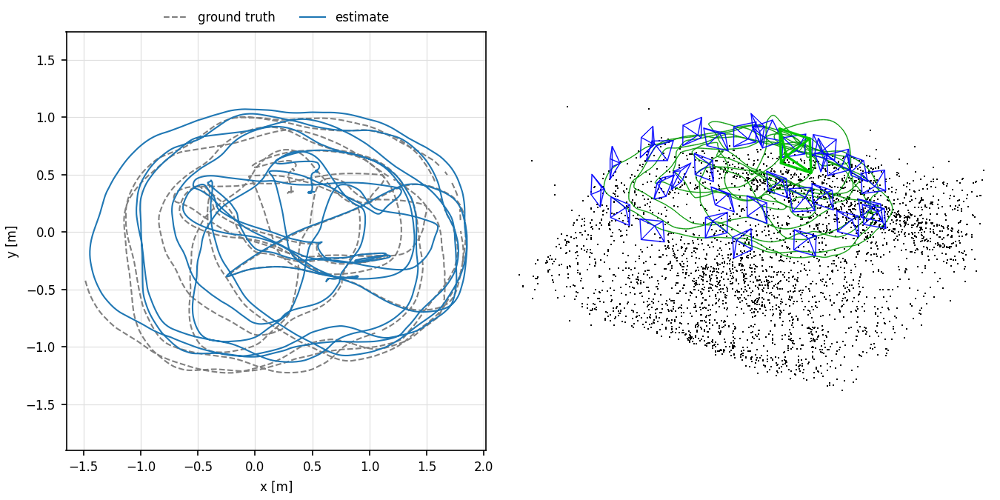

# Deep Visual SLAM: Monocular Metric Visual Odometry with Self-Supervised Depth

[](LICENSE)
[](https://github.com/chansoopark98/Deep-Visual-SLAM/releases/tag/v0.1.0)
[](https://github.com/chansoopark98/Deep-Visual-SLAM/releases)
[](pyproject.toml)
[](https://pytorch.org)
[](https://github.com/chansoopark98/Deep-Visual-SLAM)

<p align="center">
  
</p>

<p align="center"><sub>TUM-VI <code>room6</code>, a room not used for training or tuning. Left: tracked features. Middle: 3D map, keyframes and current camera. Right: top-down trajectory vs. ground truth, metric, no alignment.</sub></p>

`dvslam` is a **monocular visual odometry** (visual SLAM front end, no loop closure) system that recovers **metric
scale** from a single RGB camera. A **self-supervised monocular depth estimation** network supplies the scale prior;
**RAFT optical flow** tracks, PnP and a **sliding-window bundle adjustment** estimate the pose, and a dense
**photometric refinement** step polishes it. Optional **LoRA test-time adaptation** adapts the depth network to a new
sequence. It is written in PyTorch and evaluated on the TUM-VI indoor benchmark, for robotics and AR use cases.

## Highlights

- Single RGB camera at inference; stereo images and the gyroscope are used only to train the depth network.
- Metric trajectories without scale alignment: one global log-scale ties the window BA to the learned depth prior.
- Dense RAFT-large flow tracks, sliding-window BA and a GPU photometric refinement ([pipeline](docs/PIPELINE.md)).
- Released depth weights, a one-command demo and a unit-test suite.

## Results on TUM-VI

Official set: `room1`–`room4` plus `room6`, 12,447 frame pairs, cam0 only.

| Metric | Value | Target |
|---|---|---|
| Translation step error | **2.482 ± 0.010 %** | <= 2.96 % |
| Rotation error | **0.100°** | <= 3.4° |

| Room | Translation step error | Rotation error | ATE-SE(3) |
|---|---|---|---|
| room1 | 2.041 % | 0.090° | 0.098 m |
| room2 | 1.712 % | 0.120° | 0.301 m |
| room3 | 2.081 % | 0.121° | 0.125 m |
| room4 | 2.764 % | 0.086° | 0.071 m |
| room5 (validation) | 3.279 % | 0.090° | 0.413 m |
| room6 (unseen) | 3.918 % | 0.084° | 0.174 m |

<p align="center">
  
</p>

`room1`–`room4` are the depth network's training rooms; `room6` is the only unseen room in the official set and
`room5` was used to select the configuration, so `room6` is not a pristine test set. Metric definitions, the unseen-room
study and caveats are in [docs/EVALUATION.md](docs/EVALUATION.md). Runtime is about 137 ms/frame on an RTX 5090, which is not real time.

## Quick start

Requires Linux, Python >= 3.10 and an NVIDIA GPU (the unit tests run on the CPU).

```bash
git clone https://github.com/chansoopark98/Deep-Visual-SLAM.git
cd Deep-Visual-SLAM
TORCH_INDEX_URL=https://download.pytorch.org/whl/cu128 bash scripts/setup_env.sh   # venv + PyTorch (CUDA 12.8) + package
source .venv/bin/activate
```

**Data.** Download TUM-VI (exported / euroc / 512_16, CC BY 4.0). Layouts, caches and troubleshooting are in
[docs/DATASETS.md](docs/DATASETS.md).

```bash
export DVSLAM_TUMVI_ROOT=$PWD/data/tum_vi
export DVSLAM_CACHE_ROOT=$PWD/runs/cache
bash scripts/fetch_datasets.sh tumvi room5        # about 1.7 GB per room; the demo needs only the room it runs
```

**Weights.** Release [`v0.1.0`](https://github.com/chansoopark98/Deep-Visual-SLAM/releases/tag/v0.1.0)
(research release). SHA-256 checksums are verified. RAFT-large weights are downloaded by torchvision on first use.

```bash
bash scripts/download_weights.sh                  # -> weights/dvslam/
```

**Demo.** Runs the tracker over one room, scores it and renders a GIF into `runs/demo/<room>-<depth>-<timestamp>/`.

```bash
bash scripts/demo_tumvi.sh room5                  # room1..room6, default room5
```

Expected for `room5` on an RTX 5090: translation step error 3.210 %, rotation error 0.090°, about 410 s.

**Tests.**

```bash
bash scripts/run_tests.sh                         # unit tests + ruff report
```

## Documentation

| Document | Content |
|---|---|
| [docs/PIPELINE.md](docs/PIPELINE.md) | Pipeline stages, tracker options, repository layout |
| [docs/EVALUATION.md](docs/EVALUATION.md) | Metrics, full TUM-VI results, reproducing the evaluation, caveats |
| [docs/TRAINING.md](docs/TRAINING.md) | Depth network training, learned photometric weights, test-time adaptation, weight export |
| [docs/DATASETS.md](docs/DATASETS.md) | Dataset layouts, download, rectified-image cache |
| [docs/OTHER_DATASETS.md](docs/OTHER_DATASETS.md) | Zero-shot EuRoC and Redwood results and limitations |
| [docs/LEGACY.md](docs/LEGACY.md) | Earlier Monodepth2-style branches |

## Citation

Citation metadata is in [`CITATION.cff`](CITATION.cff) (GitHub shows a "Cite this repository" button).

```bibtex
@software{chansoopark98_deep_visual_slam_2026,
  author  = {chansoopark98},
  title   = {Deep Visual SLAM: Monocular Metric Visual Odometry with Self-Supervised Depth},
  year    = {2026},
  version = {0.1.0},
  url     = {https://github.com/chansoopark98/Deep-Visual-SLAM}
}
```

## License

MIT, see [LICENSE](LICENSE). The weights are derived from TUM-VI (CC BY 4.0); cite the dataset when you use them.

## Acknowledgements

- [Monodepth2](https://github.com/nianticlabs/monodepth2): Godard et al., *Digging into Self-Supervised Monocular Depth Prediction*, ICCV 2019
- [RAFT](https://github.com/princeton-vl/RAFT): Teed and Deng, *RAFT: Recurrent All-Pairs Field Transforms for Optical Flow*, ECCV 2020 (torchvision `raft_large`)
- [TUM-VI](https://cvg.cit.tum.de/data/datasets/visual-inertial-dataset): Schubert et al., *The TUM VI Benchmark for Evaluating Visual-Inertial Odometry*, IROS 2018
- [LoRA](https://arxiv.org/abs/2106.09685): Hu et al., *LoRA: Low-Rank Adaptation of Large Language Models*, 2021
- [evo](https://github.com/MichaelGrupp/evo): Grupp, trajectory plot style followed by the figures
