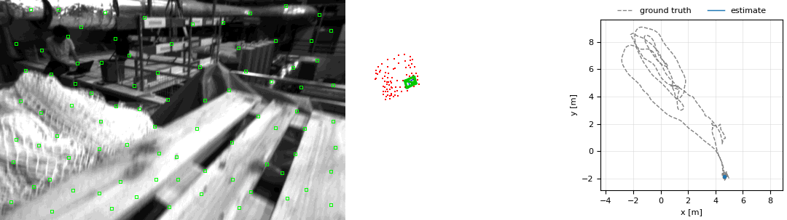
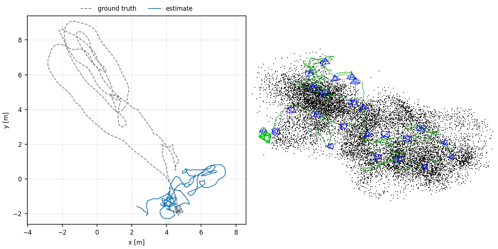
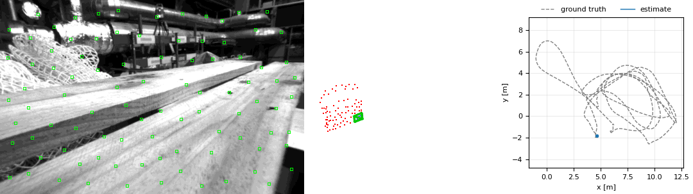
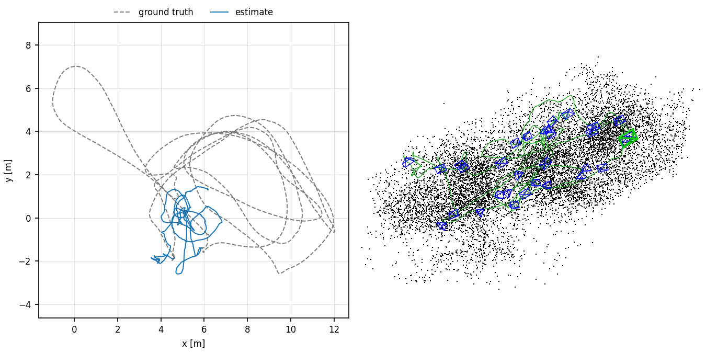
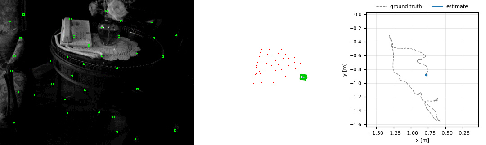
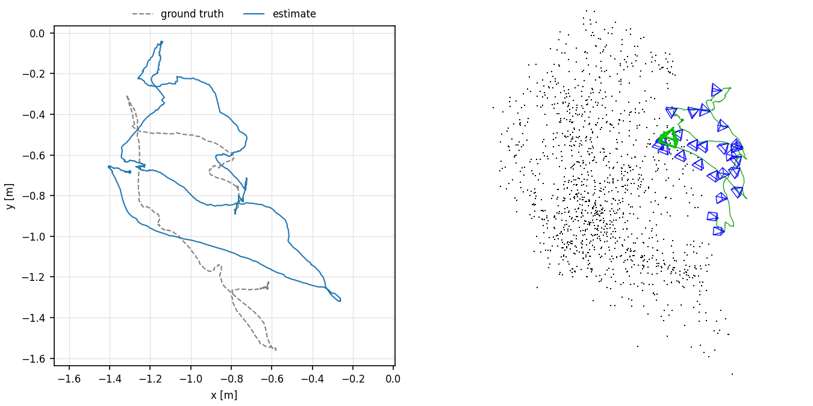

# Other datasets: EuRoC and Redwood (zero-shot)

The headline results of this repository are on TUM-VI (see [EVALUATION.md](EVALUATION.md)). This page shows the same
pipeline run on EuRoC and Redwood **without retraining**. Each sequence has an animated GIF and a static geometry
figure (`media/*_geometry.png`: evo-style 2D trajectory and the final 3D map).

<table>
  <tr>
    <td align="center"><br><sub>EuRoC <code>MH_01_easy</code>: the track diverges and is mis-scaled.</sub></td>
    <td align="center"><br><sub>Geometry, <code>MH_01_easy</code>.</sub></td>
  </tr>
  <tr>
    <td align="center"><br><sub>EuRoC <code>MH_03_medium</code>: the track diverges and is mis-scaled.</sub></td>
    <td align="center"><br><sub>Geometry, <code>MH_03_medium</code>.</sub></td>
  </tr>
  <tr>
    <td align="center"><br><sub>Redwood <code>bedroom</code>: mis-scaled; the reference poses are inaccurate.</sub></td>
    <td align="center"><br><sub>Geometry, <code>bedroom</code>.</sub></td>
  </tr>
</table>

Pairs t >= 1 with ground truth at both ends, start frame 0, final configuration, live depth from
`dvslam_depth_hints_core.pt`. ATE is the RMSE after SE(3) alignment; the other two metrics use no alignment
(see [Metric](EVALUATION.md#metric)).

| Sequence | Frames | Translation step error | Rotation error | ATE |
|---|---|---|---|---|
| TUM-VI room6 (unseen room) | 2617 | 3.98 % | 0.084° | 0.175 m |
| EuRoC MH_01_easy (zero-shot) | 3638 | 178.97 % | 0.188° | 3.06 m |
| EuRoC MH_03_medium (zero-shot) | 2631 | 116.34 % | 0.183° | 3.18 m |
| Redwood bedroom (zero-shot) | 1097 | 64.19 % | 0.120° | 0.31 m |

**Limitations.** The depth network was trained only on TUM-VI `room1`–`room4`. On EuRoC and Redwood the images are
re-projected into its training camera (pinhole, 512 x 512, f = 190) and its metric scale does not transfer: the median
predicted / ground-truth step length is 0.30–0.40 on EuRoC and 1.35 on Redwood. The trajectories are therefore
mis-scaled, and the EuRoC tracks diverge. The Redwood reference poses are known to be inaccurate. The rotation error
stays small on all sequences.

## Running the tracker on another dataset

`scripts/demo_track.py` runs the tracker on one sequence of any dataset (`--dataset tumvi|euroc|redwood`) and writes
everything the renderer needs (`<scene>.inc.npz`, `.extra.npz`, `.tracks.npz`, `.map.npz`, `.seq.npz`, `.cpu.json`).
It takes the tracker options as repeated `--opt k=v`; use the final-candidate list from
[PIPELINE.md](PIPELINE.md#tracker-options-final-candidate). Set `DVSLAM_EUROC_ROOT` / `DVSLAM_REDWOOD_ROOT` first
(see [DATASETS.md](DATASETS.md)).

```bash
OPTS="--opt prior=ssl --opt prior_ckpt=weights/dvslam/dvslam_depth_hints_core.pt --opt quality=0.001 --opt lk_win=15
  --opt jump_ref_tracked=true --opt photo=all --opt photo_tol=0.01 --opt photo_levels=1 --opt ba_nfev=10
  --opt n_features=250 --opt kf_ratio=0.3 --opt prior_per_kf=false --opt g_tau=5 --opt flow_cache=raft_large
  --opt kf_refine=0 --opt photo_cell=1 --opt photo_grad=0.002 --opt photo_bidir=true --opt photo_backend=torch"

python scripts/demo_track.py --dataset euroc --scene MH_01_easy --out runs/demo/euroc $OPTS
python scripts/render_demo.py --run runs/demo/euroc --scene MH_01_easy \
    --out media/euroc_MH_01_easy_demo.gif --png media/euroc_MH_01_easy_geometry.png --stride 17 --fps 10
```

| Option | Default | Meaning |
|---|---|---|
| `--dataset` | required | `redwood`, `tumvi` or `euroc` |
| `--scene` | required | Sequence name, e.g. `room6`, `MH_01_easy`, `bedroom` |
| `--out` | required | Output directory |
| `--split` | inferred (`test` for Redwood) | Dataset split |
| `--camera` | `tumvi` except for TUM-VI | `tumvi` re-projects the images into the TUM-VI 512 x 512, f = 190 pinhole camera, which the depth network requires; `native` keeps the dataset camera |
| `--erode` | `8` | Pixels the valid-region mask is eroded by (`--camera tumvi`) |
| `--frames` | `0` | Track only the first N frames (`0` = all) |
| `--cv-threads` | unset | OpenCV thread count |

The scores above come from such runs: the depth network sees the re-projected image, so its depth is zero-shot there.
Re-projected canvases are cached under `DVSLAM_CACHE_ROOT/<dataset>/<scene>/tumvi_512_f190`.

## Rendering

`scripts/render_demo.py` draws a tracker run as an animated GIF (`--out`) and a static geometry figure (`--png`: top-down
trajectory and final 3D map):

```bash
python scripts/render_demo.py --run runs/demo/<run> --scene room6 \
    --out media/room6_demo.gif --png media/room6_geometry.png \
    [--start 0 --end -1 --stride 11 --fps 10 --width 1080 --dpi 150]
```

At least one of `--out` and `--png` is required. Other options: `--grays`, `--azim`, `--elev`, `--margin`, `--min-obs`,
`--kf-size`, `--kf-spacing` (3D view) and `--data-root` (TUM-VI root for runs without `<scene>.seq.npz`); `-h` lists all.
The script prints the frame count, translation step error, rotation error and ATE (SE(3)) of the rendered run.
