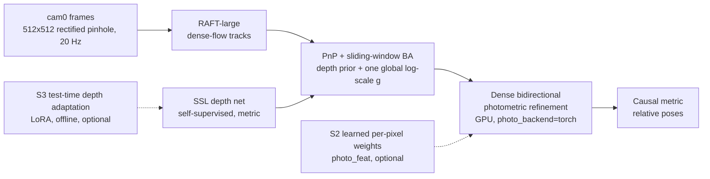

# Pipeline and repository layout

`dvslam` is a monocular metric visual odometry system for low-parallax, high-frame-rate indoor sequences. Geometry
carries the pose path: dense optical-flow tracks, PnP and a sliding-window bundle adjustment, refined by a dense
photometric step. A self-supervised depth network provides the metric scale prior. Inference uses a single RGB camera;
stereo images and the gyroscope are used only while training the depth network. There is no loop closure.

## Pipeline



| Stage | What it does | Code |
|---|---|---|
| Tracking and window BA | RAFT-large flow every frame gives point tracks; PnP plus a sliding-window bundle adjustment estimate poses. The depth prior constrains the metric scale through one global log-scale `g`. | `dvslam/odometry/klt_window.py` |
| Photometric refinement | Dense bidirectional photometric alignment refines each relative pose. `photo_backend=torch` runs it on the GPU. | `dvslam/odometry/klt_photo_torch.py` |
| S2 learned weights (optional) | A small U-Net (`PhotoNet`) predicts per-pixel log weights for the refinement (`photo_feat=<file>`). | `dvslam/odometry/photo_learned.py` |
| SSL depth network | ResNet-18 depth and pose networks trained self-supervised on TUM-VI. Stereo images, gyroscope and stereo depth hints are used only for training; inference is cam0 only. | `dvslam/ssl/` |
| S3 test-time adaptation (optional) | One offline pass adapts the depth decoder to a test sequence with a LoRA adapter, using the tracker's own poses as pseudo-labels. No cam1, IMU or ground truth. | `dvslam/ssl/adapter.py`, `apps/calib_s3.py` |

The output is a causal chain of metric relative poses, one per frame.

## Tracker options (final candidate)

The final-candidate tracker is selected with this option string (`--opt k=v`, repeated). `prior_ckpt` points at the
depth network from the [release](../README.md#quick-start).

```
prior=ssl prior_ckpt=weights/dvslam/dvslam_depth_hints_core.pt quality=0.001 lk_win=15 jump_ref_tracked=true
photo=all photo_tol=0.01 photo_levels=1 ba_nfev=10 n_features=250 kf_ratio=0.3 prior_per_kf=false g_tau=5
flow_cache=raft_large kf_refine=0 photo_cell=1 photo_grad=0.002 photo_bidir=true photo_backend=torch
```

Usage examples are in [EVALUATION.md](EVALUATION.md#reproducing-the-evaluation).

## Repository layout

```
apps/                  Entry points: run_sequence, eval_pairs, train_ssl, train_photo_s2, calib_s3 (train, cache)
configs/               ssl_tumvi.yaml (SSL depth training)
dvslam/
  data/                TUM-VI, EuRoC, Redwood loaders, dataset registry, rectified-image cache
  depth/               Depth priors behind the tracker (SSL network; perturbed GT depth for tests)
  odometry/            Tracker: klt_window.py (final pipeline) and its parts (klt_pnp, klt_flow, klt_photo,
                       klt_photo_torch, klt_depth_cache, klt_lag, photo_learned, base)
  ssl/                 Self-supervised depth + pose training, predictor, LoRA adapter (adapter.py)
  eval/                Pair-wise pose-error metrics and diagnostics
  geometry/            SE(3) helpers
scripts/               setup_env.sh, download_weights.sh, fetch_datasets.sh, run_tests.sh, demo_tumvi.sh,
                       demo_track.py (any dataset), render_demo.py (GIF and geometry PNG), export_release_weights.py,
                       exp003_*.py / exp009_stereo_depth.py / cache_stereo_hints.py / s2_dump_pairs.py
                       (tracking log, scoring, depth caches, S2 dumps)
tests/                 pytest suite
docs/                  Documentation (see the README)
media/                 Demo GIFs and geometry figures (TUM-VI room6, EuRoC MH_01 / MH_03, Redwood bedroom)
model/                 ResNet encoder and depth decoder used by dvslam/ssl
weights/dvslam/        Downloaded release weights (git-ignored)
```

Top level: `README.md`, `CITATION.cff`, `LICENSE`, `CODE_OF_CONDUCT.md`, `pyproject.toml`, `requirements.txt`.
